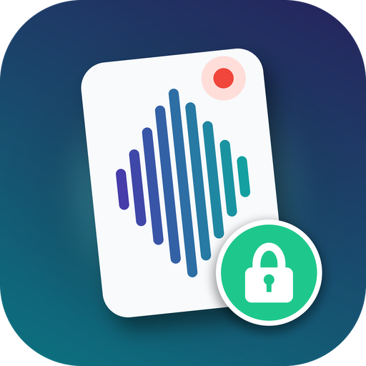

<p align="center"></p>

<h1 align="center">Private Pocket</h1>

A local-first, open-source companion app for the [Pocket](https://heypocket.com) voice
recorder. It's for people who love the hardware but need their recordings to stay on
their own devices.

Pocket is a genuinely nice recorder. It's a thin card with a 62 GB drive (thousands of
hours of speech) and a light that tells everyone in the room when it is recording. One button press and you're recording. The official app and cloud add excellent
transcription, summaries and search, and for most people they are the right choice.

Some people can't send audio to any cloud: lawyers, clinicians, journalists, anyone
bound by client confidentiality or EU/UK data-residency rules, or anyone who'd simply rather
not. Private Pocket talks to the recorder directly over Bluetooth and keeps everything on
the iPhone. Optionally, it uses a server **you** choose.

> Not affiliated with, endorsed by or supported by Open Vision Engineering, Inc. (Pocket).
> "Pocket" is their trademark, used here only to say which device this works with.

## Why this exists

We bought a Pocket to use in Europe, for conversations that include other people. Before
putting real conversations on it, we read Pocket's privacy policy, terms and trust page.
**The lack of meaningful GDPR information is what led to this project.** The trust page
shows a GDPR badge, but the documents behind it don't give a European user what the law
requires. Testing the device then showed that its encryption claims don't match what it
does either.

*Sources:* [Privacy Policy](https://heypocket.com/pages/privacy) (last modified
8 September 2025), [Terms of Use](https://heypocket.com/pages/terms) (15 September 2025)
and [Trust page](https://heypocket.com/pages/pocket-trust), all read on 19 October 2026,
plus our own tests on two cards running firmware 1.8. We'll gladly update this section
if Pocket addresses these points.

### GDPR: the claims and the reality

| Pocket says | What we found |
|---|---|
| A **"GDPR"** badge on the trust page, beside SOC 2 Type I, SOC 2 Type II and "HIPPA" (sic) | No report, certificate or audit is linked from any of them. GDPR has no compliance badge to display. |
| "Transcription and summarization run on US-based cloud infrastructure" | Recordings leave Europe, but the policy names **no transfer safeguard**: no Standard Contractual Clauses, EU–US Data Privacy Framework or UK extension (GDPR Arts. 44–49, 13(1)(f)). |
| Controller: Open Vision Engineering, Inc., Delaware | **No EU or UK representative** (Art. 27) and **no data protection officer contact**. |
| Recordings go to "cloud/AI vendors" for transcription and model processing | **No list of subprocessors.** Your voice, and the voices of everyone you recorded, go to companies that aren't named. |
| Data is kept "only for as long as necessary" | **No retention periods.** Deleted accounts linger in backups for unstated "scheduled cycles" (Art. 13(2)(a)). |
| One sentence on legal bases "(EEA/UK where applicable)" | **No mention of the right to complain to a supervisory authority** (Art. 13(2)(d)). |
| "We don't share your data with third parties" (trust page) | The privacy policy allows advertising cookies and SDKs, and says these "may be deemed a 'sale' or 'sharing' of personal information". It ignores Do Not Track. |
| Health or other sensitive details: "If you choose to record or otherwise include sensitive information…" | Responsibility for special-category data (Art. 9) is passed to the user, including for bystanders who never agreed to anything. |

We also saw the official app do this: whenever it connects to the card, it downloads every
recording it finds and syncs it to Pocket's cloud. That includes recordings made by other
software.

### Encryption: the claims and the reality

| Pocket says (trust page) | What we observed |
|---|---|
| "Audio is written to encrypted storage the moment it leaves the microphone. Pull the device apart and there is nothing readable on it without your account." | With USB access (Web Sync) on, the card mounts on any computer as an ordinary drive of **plain, unencrypted MP3 files**. No account is involved. Over Bluetooth, the same plain MP3s can be downloaded by anyone who has the session key. |
| "The recording is never in the clear on the wire, on your network or on ours." | From card to phone, recordings travel over Bluetooth as **plain MP3 frames**, with no Bluetooth pairing or link encryption, so the audio is in the clear over the air. **While a recording is being made, the card streams it to any device that has connected, with no key at all.** *(We didn't examine the Wi-Fi or cloud upload path.)* |
| "Built on rigorous security standards, strong encryption…", "security at every layer" | **The Bluetooth link has no cryptography.** The card accepts connections from any device without pairing, and anyone in range can read its battery level or receive the live recording. The only access control is a 16-character key sent **in clear text** at every connection, which unlocks listing, downloading and starting or stopping recordings. Keys are added by **whoever connects while the card is in pairing mode** (side button held for 5 seconds), with no check of who that is, and earlier keys stay valid. |

To Pocket's credit, USB access has been **off by default** since firmware 1.2.

These findings are about how the device and its documentation work today, and they are
fixable. Possible fixes: Bluetooth LE Secure Connections pairing, a per-device key that can
be rotated, real encryption at rest, an EU processing region, and a GDPR-complete privacy
notice. Until then, Private Pocket keeps your recordings on your own phone.

## What it does

- **Pairs like the official app.** Hold the Pocket's side button for 5 seconds until it
  blinks blue; the app pairs by itself and the light goes solid a little later. No
  account, nothing to type, nothing to tap. Even before pairing, every recording started
  with the button streams to the phone.
- **Record and stream.** Start and stop the Pocket from the phone, or use its button.
  The phone stays connected, also with the app in the background, so every recording
  streams in live and is saved and transcribed as you speak, with no download afterwards.
- **Lives in the Dynamic Island.** While the Pocket is connected, the Dynamic Island and
  the Lock Screen show its light and battery. When it records, even with the phone locked,
  that turns amber with the timer and the words as they arrive, with a Stop button, and
  shows the saved length for a moment after. Inside the app a bar above the tabs shows the
  recording on every screen.
- **A walkthrough on first use.** Seven swipe screens, made the way the manufacturer would: wake it, pair, record, the switch, what the light means, reset. Again from Settings any time.
- **Moments, not files.** Every recording is a card: what kind of conversation it was, the first thing said, who was there. A model reads each one for the actions, what others promised, what is coming up and who was mentioned; Add puts an action in Reminders or a date in Calendar.
- **Insights.** What only adding up many conversations shows: a promise that fell due with nothing from that person since, what you owe others and for how long, a thread that keeps coming up without a decision, meetings that decided nothing, your follow-through against last week, a figure that moved, the balance of work and life. Each with a small chart, a sentence and a button that does the obvious thing. Then the days, what needs you now, and the record. Worked out on the phone from the readings; only the briefing is written by a model.
- **Your own server, when reachable.** A DGX Spark or any OpenAI-compatible server over Tailscale: bigger models, speakers, any language. Used while it answers, and everything falls back to the phone when it does not.
- **Control Center, Siri, Shortcuts and the Action button.** A Pocket toggle in Control
  Center and on the Lock Screen starts and stops the card without unlocking, and shows
  whether it is recording; "Start recording on Private Pocket" works wherever Shortcuts do.
- **Fetches by itself.** Anything recorded while the phone was away comes over
  Bluetooth as soon as the Pocket reconnects, at about 40–60 KB/s (an hour of audio in
  about five minutes). No tap, cable, Wi-Fi or account needed.
- **Transcribe.** Choose Apple's on-device speech recognition (`SpeechAnalyzer`) in the
  language you pick, or any OpenAI-compatible Whisper server, which can detect the language itself.
- **Speakers.** Optionally sends audio to a diarisation server to label who spoke when.
  You can name the speakers ("Speaker 2" → "Daniel").
- **Summarise and ask.** Summaries and questions across one recording or a date range
  ("who was mentioned?", "which restaurant was it?"). These use Apple Intelligence
  (`FoundationModels`) on the phone, or any OpenAI-compatible model server.
- **Organised.** Recordings are named by where and when they were made (from the phone's
  location; the Pocket has no GPS), are searchable, and record which Pocket made them.
  Several Pockets are supported.
- **Free up space.** Bluetooth has no delete command, so the app guides the USB-C route:
  it shows which files on the Pocket's drive are safely backed up, then deletes those.

## What leaves the phone

| Setting | Audio | Transcripts | Anything to Pocket's cloud |
|---|---|---|---|
| Everything "On this iPhone" (default with no server configured) | stays on the phone | stays on the phone | no |
| Speech to text on a server | to **your** server | — | no |
| Language model on a server | — | to **your** server | no |
| Speakers on | to **your** diarisation server | — | no |

Place names use Apple's geocoder (coordinates only), and can be turned off.

## Requirements

- An iPhone on iOS 27, built with Xcode 27 and [XcodeGen](https://github.com/yonaskolb/XcodeGen).
  On-device summaries need Apple Intelligence.
- A Pocket recorder. Tested on firmware 1.8 / Wi-Fi V9 with two cards.
- Nothing else. The app pairs with the Pocket itself, the same way the official app
  does; see [Session key and pairing](ble/PROTOCOL.md#session-key-and-pairing) for
  what happens underneath.

## Getting started

```bash
git clone https://github.com/incept5-ai/private-pocket && cd private-pocket
cp ble/.env.example ble/.env          # optional: your Pocket and server defaults
cd ios/PrivatePocket
./gen-defaults.sh && xcodegen generate && open PrivatePocket.xcodeproj   # set your team, run on your phone
```

You can skip `.env`: open the app, tap **Add Pocket**, then hold the Pocket's side
button for 5 seconds until it blinks blue; the app pairs by itself (the light keeps
blinking for a short while, then turns solid). If Xcode has no
Apple ID signed in, `sign-install.sh` builds unsigned and signs with an existing
development profile (see `signing.env.example`).

**Important:** the Pocket talks to one phone at a time. If the official app is installed
with Bluetooth on, it may connect first and sync recordings to its cloud as designed. Use
one app or the other. Pairing here adds a key of this app's own; the official app's key
keeps working if you go back to it.

## Using your own server

Any OpenAI-compatible endpoint works: `…/v1/audio/transcriptions` (with
`verbose_json` and word timestamps, e.g. whisper.cpp or faster-whisper servers) and
`…/v1/chat/completions` (vLLM, llama.cpp, Ollama, LM Studio…). Speaker labels need a
`POST …/v1/audio/diarize` that takes a multipart `file` and returns
`{"segments": [{"start": 0.0, "end": 2.1, "speaker": 0}, …]}`. Set the server in the app,
or bake in defaults through `ble/.env` (`SERVER_URL`, `STT_MODEL`, `LLM_MODEL`,
`DIARIZE_URLS`, `SERVER_KEY`).

## Repository

| Path | What |
|---|---|
| [`ble/PROTOCOL.md`](ble/PROTOCOL.md) | The Bluetooth protocol: commands, audio, sync, live streaming, USB delete |
| `ble/*.py` | Small Mac tools (Python + [bleak](https://github.com/hbldh/bleak), run with `uv run`): scan, dump services, send commands, download |
| [`ios/PrivatePocket`](ios/PrivatePocket) | The SwiftUI app |

## How this was built

We built it by watching the Bluetooth traffic between our own phone and our own Pocket,
using Apple's PacketLogger, so that a different app could work with the device. No
firmware was decompiled, and no Pocket code, assets or credentials are included. The
protocol turned out to be refreshingly simple: plain-text commands and ordinary MP3 audio.
That's a credit to Pocket's engineering. It's what makes a small independent client like
this possible.

## Caveats

- A Pocket firmware update could change the protocol. Tested on 1.8.
- The session key is a shared secret sent without Bluetooth pairing. The app makes one
  when you pair and keeps it in the Keychain. If you put one in `ble/.env` for the Mac
  tools, keep it out of screenshots and repos (the file is gitignored).
- With Web Sync (USB access) on, anyone who plugs the Pocket into a computer can read
  the recordings. The app shows the setting and lets you switch it off.

## Credits

- **[Pocket](https://heypocket.com)** (Open Vision Engineering, Inc., San Francisco) made the
  recorder. It's good hardware built on open, sensible formats (MP3 files, an ordinary USB
  drive, plain-text Bluetooth commands), and that's the only reason a project like this is possible.
  If you don't need everything kept local, their app and service are the easy choice.
- **Actions** (炬芯科技 Actions Technology, Zhuhai, China). The Pocket identifies over USB
  as an Actions device (vendor ID `0x10d6`). Actions makes Bluetooth audio chips of
  this kind, and its tidy GATT layout underpins the protocol described in `ble/`.
- **The Qwen team** (Alibaba, China): open-weight models such as Qwen3.6, used in the
  examples here, work very well as a self-hosted model for summaries and questions.
- **Whisper** (OpenAI) and **whisper.cpp** for self-hosted speech to text, Apple's
  `SpeechAnalyzer` and `FoundationModels` for the on-device versions,
  [bleak](https://github.com/hbldh/bleak) for the Mac tools, and
  [XcodeGen](https://github.com/yonaskolb/XcodeGen).

## License

[MIT](LICENSE)
