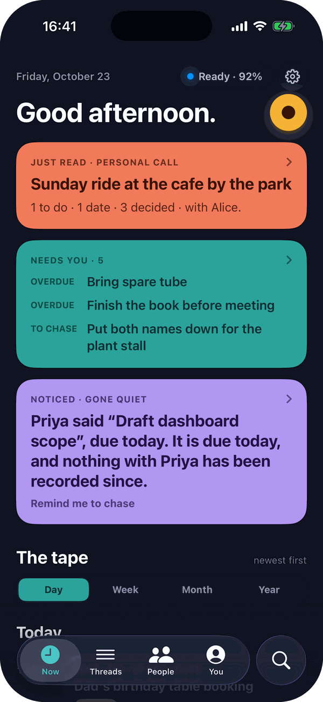
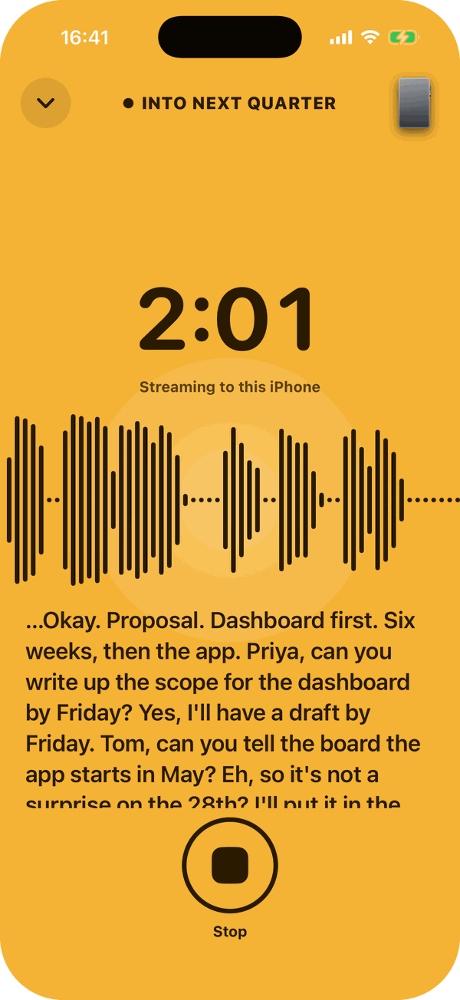
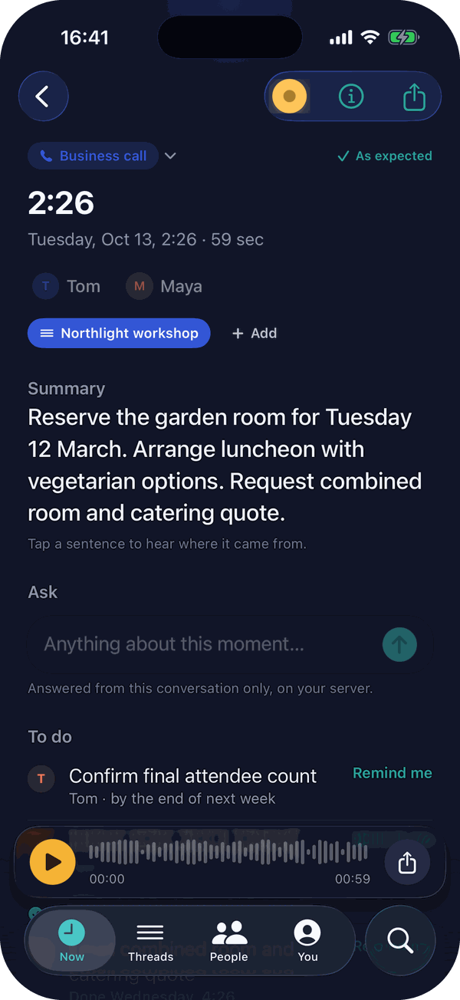
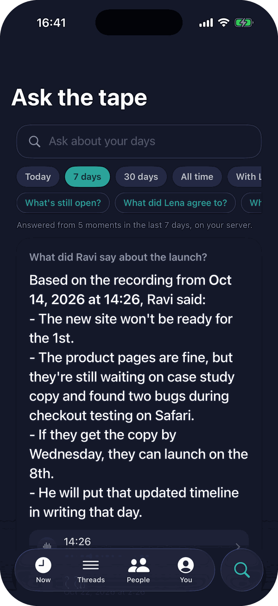
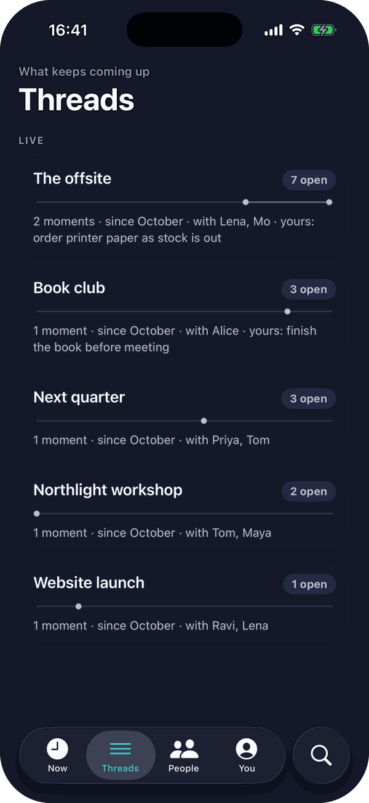
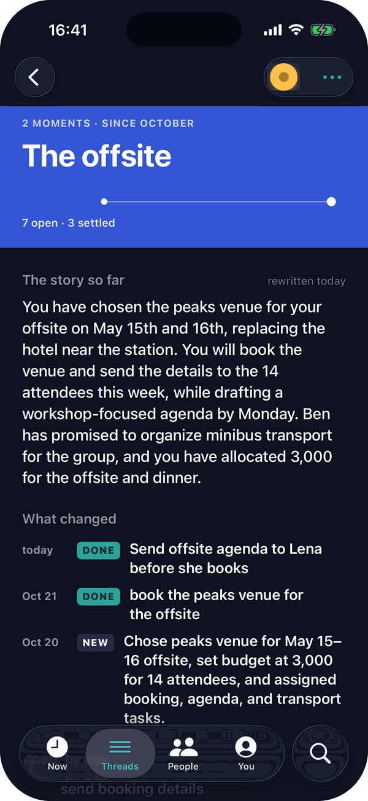
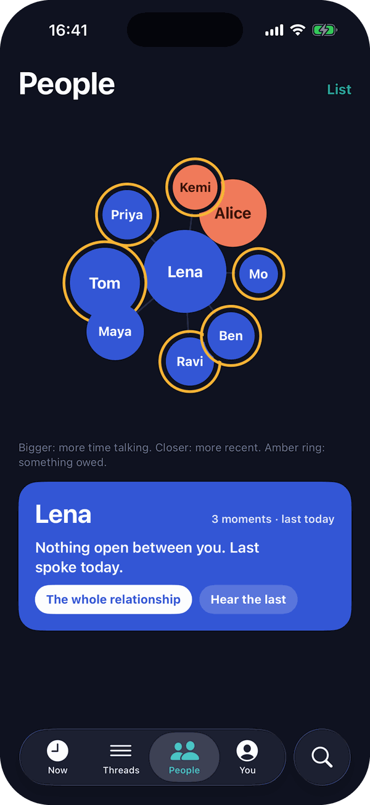
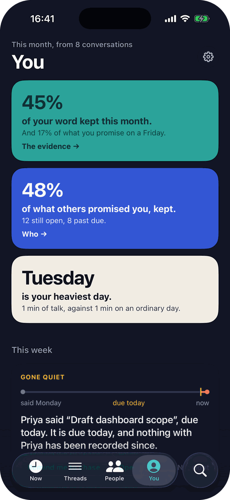

<p align="center"></p>

<h1 align="center">Private Pocket</h1>

<p align="center"><b>Press once. Hear everything.</b><br>
Your conversations, written down and read for you, on your iPhone and nowhere else.</p>

Private Pocket is a free, open-source companion app for the [Pocket](https://heypocket.com)
voice recorder, made for people who love the hardware and need their conversations to stay
their own. Press the button on the card and the conversation streams to your iPhone, is
written down as it is spoken, and is read for what matters: what was decided, what you
promised, what you are owed, and when it comes up again. No account. No cloud. Nothing
leaves your phone unless you point it at a server of your own.

> Not affiliated with, endorsed by or supported by Open Vision Engineering, Inc. (Pocket).
> "Pocket" is their trademark, used here only to say which device this works with.

## Build 1: from a recorder to a memory

This is the first build of a new Private Pocket, and it is experimental. The first version
was a good recorder with a list of files. This one is built around what conversations leave
behind: the promises and the decisions, the people, and the subjects you keep coming back
to. It all runs on the iPhone, with Apple's on-device speech recognition and Apple
Intelligence, or on a model server you run yourself.

<table>
  <tr>
    <td align="center" valign="top"><br><b>Now</b><br><sub>The right thing for the hour</sub></td>
    <td align="center" valign="top"><br><b>Recording</b><br><sub>The room, read as it happens</sub></td>
    <td align="center" valign="top"><br><b>A moment</b><br><sub>What was decided, what's yours</sub></td>
    <td align="center" valign="top"><br><b>Ask</b><br><sub>Answers from everything you said</sub></td>
  </tr>
  <tr>
    <td align="center" valign="top"><br><b>Threads</b><br><sub>What you keep coming back to</sub></td>
    <td align="center" valign="top"><br><b>A thread</b><br><sub>The story so far</sub></td>
    <td align="center" valign="top"><br><b>People</b><br><sub>Who, and what stands between you</sub></td>
    <td align="center" valign="top"><br><b>You</b><br><sub>Your word, kept</sub></td>
  </tr>
</table>

<sub>The screens show the app's built-in sample moments: eight short, made-up conversations,
transcribed by Whisper and read by an open model on a Mac standing in for your own server,
with a few days' to-dos ticked off.</sub>

### Press once. The phone does the rest.

The Pocket is a card with one button and a light. Press it and the conversation streams to
your iPhone as it happens, even locked, even in a bag. It is written down as it is spoken
and saved the moment you stop, with nothing to download. If the phone was out of reach, the
recording arrives by itself the next time the two are together. Pairing is holding the
button for five seconds. There is nothing to sign up for and nothing to type.

### The room, read as it happens

While it records, the whole screen becomes the recording: the timer, a waveform that
breathes with the room, and the words as they arrive, large enough to read across a table.
To-dos, dates and promises appear as they are said; tick what is right and cross what is
not. Say "Pocket, remind me to…" and it is done. Say "Pocket, what did Ravi say the date
was?" and it is answered from your own recordings, phone still in the bag.

### Now, and the tape

The app opens on the right thing for the hour. Before a meeting, a brief, with a nudge ten
minutes ahead: what is open with the people you are about to see, what you owe them, the
last figure that was mentioned. After a conversation, what was just read. In the morning, yesterday set, with
its key lines to listen back to. At six, what the day decided and what it left open. Under
it all is the tape: every conversation as a band in the colour of its kind, by day, week,
month and year.

### Every conversation, read for you

Each moment opens with a few sentences written to you: what happened, and what it means for
you. Then the to-dos and the dates, each with the words they came from. Send them to
Reminders and Calendar, and when you tick one off there, it is ticked here too. The
decisions, the questions left hanging, the figures as they were said. Who spoke, named from
the calendar invite once the conversation shows who is who. The transcript follows the
audio: hold any line to hear it, share it as a clip, or make it a to-do.

### Threads that remember

The subjects you keep coming back to become threads, found in your conversations by
themselves. Each new conversation is read against the story so far, so a thread shows what
changed and when, what is still open and for how long, and what quietly lapsed. When a
subject returns after weeks of quiet, Now tells you what was said last time, and so does the
recording screen the moment it is named in the room. Press Record on a thread to record
straight into it.

### People, and what stands between you

A map of who you talk to: bigger the more you talk, closer the more recently, with an amber
ring where something is owed. Open anyone to see the promises both ways, the threads you
share and everything you have said together.

### You, in the mirror

What only weeks of conversations can show. How often you keep your word, and the weekday you
keep it least. How often others keep theirs. Who you are drifting from. What keeps being
raised and never decided. Your heaviest day.

### Ask the tape

Ask anything about today, the last week or month, or everything: who agreed to what, which
restaurant it was, what is still open with Maya. The answer comes with the moments it was
drawn from.

### Everywhere you are

The Pocket lives in the Dynamic Island and on the Lock Screen: its light and battery while it
waits, then amber with the timer, the waveform and the words while it records, with a Stop
button. A Control Center toggle, Siri, Shortcuts and the Action button start and stop it
without unlocking the phone.

### Yours, and only yours

Out of the box, everything happens on the iPhone: Apple's on-device speech recognition
writes it down and Apple Intelligence reads it. For bigger models, more languages or
speaker labels, point it at a server you run yourself, at home or in the office. It is used
while it answers, and everything falls back to the phone when it does not. Your moments are
kept out of iCloud backups, and Export everything hands you a copy whenever you want one.

### Built to be relied on

This build was reviewed end to end for the ways a recording can go missing, and fixed. A
stream with a gap is replaced by the Pocket's own file, and if that can't be fetched yet,
the stream is kept until a later sync can. Your edits survive every re-read, deleted moments
stay deleted, and the phone reconnects to the Pocket in the background by itself.

## Also in this build

- **Pairs like the official app.** Hold the Pocket's side button for five seconds until it
  blinks blue, and the app pairs by itself. Even before pairing, every recording started
  with the button streams to the phone.
- **A walkthrough on first use.** Seven swipe screens, made the way the manufacturer would:
  wake it, pair (the page finds and adds your Pocket itself), record, the switch, what the
  light means, and the way back if it won't pair, with the reset acted out on the card.
  Again from Settings any time.
- **Fetches by itself.** Anything recorded while the phone was away comes over Bluetooth as
  soon as the Pocket reconnects, at about 40–60 KB/s (an hour of audio in about five
  minutes). No tap, cable, Wi-Fi or account needed.
- **Transcribe your way.** Apple's on-device `SpeechAnalyzer` in the language you pick, or
  any OpenAI-compatible Whisper server, which can detect the language itself.
- **Speakers.** Optionally, a diarisation server labels who spoke when. Name a speaker in a
  tap, or let the calendar invite suggest the names.
- **Share.** The recording, the transcript, or both as a zip, each named for the moment.
- **Organised.** Moments are named by where and when they happened (from the phone's
  location; the Pocket has no GPS) and remember which Pocket made them. Several Pockets are
  supported.
- **Free up space.** Bluetooth has no delete command, so the app guides the USB-C route: it
  shows which files on the Pocket's drive are safely backed up, then deletes those.

## What leaves the phone

| Setting | Audio | Transcripts | Anything to Pocket's cloud |
|---|---|---|---|
| Everything "On this iPhone" (default with no server configured) | stays on the phone | stays on the phone | no |
| Speech to text on a server | to **your** server | — | no |
| Language model on a server | — | to **your** server | no |
| Speakers on | to **your** diarisation server | — | no |

Place names use Apple's geocoder (coordinates only), and can be turned off.

## Why this exists

We bought a Pocket to use in Europe, for conversations that include other people. Before
putting real conversations on it, we read Pocket's privacy policy, terms and trust page.
**The lack of meaningful GDPR information is what led to this project.** The trust page
shows a GDPR badge, but the documents behind it don't give a European user what the law
requires. Testing the device then showed that its encryption claims don't match what it
does either.

*Sources:* [Privacy Policy](https://heypocket.com/pages/privacy) (last modified
8 September 2025), [Terms of Use](https://heypocket.com/pages/terms) (15 September 2025)
and [Trust page](https://heypocket.com/pages/pocket-trust), all read on 19 October 2026,
plus our own tests on two cards running firmware 1.8. We'll gladly update this section
if Pocket addresses these points.

### GDPR: the claims and the reality

| Pocket says | What we found |
|---|---|
| A **"GDPR"** badge on the trust page, beside SOC 2 Type I, SOC 2 Type II and "HIPPA" (sic) | No report, certificate or audit is linked from any of them. GDPR has no compliance badge to display. |
| "Transcription and summarization run on US-based cloud infrastructure" | Recordings leave Europe, but the policy names **no transfer safeguard**: no Standard Contractual Clauses, EU–US Data Privacy Framework or UK extension (GDPR Arts. 44–49, 13(1)(f)). |
| Controller: Open Vision Engineering, Inc., Delaware | **No EU or UK representative** (Art. 27) and **no data protection officer contact**. |
| Recordings go to "cloud/AI vendors" for transcription and model processing | **No list of subprocessors.** Your voice, and the voices of everyone you recorded, go to companies that aren't named. |
| Data is kept "only for as long as necessary" | **No retention periods.** Deleted accounts linger in backups for unstated "scheduled cycles" (Art. 13(2)(a)). |
| One sentence on legal bases "(EEA/UK where applicable)" | **No mention of the right to complain to a supervisory authority** (Art. 13(2)(d)). |
| "We don't share your data with third parties" (trust page) | The privacy policy allows advertising cookies and SDKs, and says these "may be deemed a 'sale' or 'sharing' of personal information". It ignores Do Not Track. |
| Health or other sensitive details: "If you choose to record or otherwise include sensitive information…" | Responsibility for special-category data (Art. 9) is passed to the user, including for bystanders who never agreed to anything. |

We also saw the official app do this: whenever it connects to the card, it downloads every
recording it finds and syncs it to Pocket's cloud. That includes recordings made by other
software.

### Encryption: the claims and the reality

| Pocket says (trust page) | What we observed |
|---|---|
| "Audio is written to encrypted storage the moment it leaves the microphone. Pull the device apart and there is nothing readable on it without your account." | With USB access (Web Sync) on, the card mounts on any computer as an ordinary drive of **plain, unencrypted MP3 files**. No account is involved. Over Bluetooth, the same plain MP3s can be downloaded by anyone who has the session key. |
| "The recording is never in the clear on the wire, on your network or on ours." | From card to phone, recordings travel over Bluetooth as **plain MP3 frames**, with no Bluetooth pairing or link encryption, so the audio is in the clear over the air. **While a recording is being made, the card streams it to any device that has connected, with no key at all.** *(We didn't examine the Wi-Fi or cloud upload path.)* |
| "Built on rigorous security standards, strong encryption…", "security at every layer" | **The Bluetooth link has no cryptography.** The card accepts connections from any device without pairing, and anyone in range can read its battery level or receive the live recording. The only access control is a 16-character key sent **in clear text** at every connection, which unlocks listing, downloading and starting or stopping recordings. Keys are added by **whoever connects while the card is in pairing mode** (side button held for 5 seconds), with no check of who that is, and earlier keys stay valid. |

To Pocket's credit, USB access has been **off by default** since firmware 1.2.

These findings are about how the device and its documentation work today, and they are
fixable. Possible fixes: Bluetooth LE Secure Connections pairing, a per-device key that can
be rotated, real encryption at rest, an EU processing region, and a GDPR-complete privacy
notice. Until then, Private Pocket keeps your recordings on your own phone.

## Requirements

- An iPhone on iOS 27, built with Xcode 27 and [XcodeGen](https://github.com/yonaskolb/XcodeGen).
  On-device summaries need Apple Intelligence.
- A Pocket recorder. Tested on firmware 1.8 / Wi-Fi V9 with two cards.
- Nothing else. The app pairs with the Pocket itself, the same way the official app
  does; see [Session key and pairing](ble/PROTOCOL.md#session-key-and-pairing) for
  what happens underneath.

## Getting started

```bash
git clone https://github.com/incept5-ai/private-pocket && cd private-pocket
cp ble/.env.example ble/.env          # optional: your Pocket and server defaults
cd ios/PrivatePocket
./gen-defaults.sh && xcodegen generate && open PrivatePocket.xcodeproj   # set your team, run on your phone
```

You can skip `.env`: open the app, tap **Add Pocket**, then hold the Pocket's side
button for 5 seconds until it blinks blue; the app pairs by itself (the light keeps
blinking for a short while, then turns solid). If Xcode has no
Apple ID signed in, `sign-install.sh` builds unsigned and signs with an existing
development profile (see `signing.env.example`).

**Important:** the Pocket talks to one phone at a time. If the official app is installed
with Bluetooth on, it may connect first and sync recordings to its cloud as designed. Use
one app or the other. Pairing here adds a key of this app's own; the official app's key
keeps working if you go back to it.

## Using your own server

Any OpenAI-compatible endpoint works: `…/v1/audio/transcriptions` (with
`verbose_json` and word timestamps, e.g. whisper.cpp or faster-whisper servers) and
`…/v1/chat/completions` (vLLM, llama.cpp, Ollama, LM Studio…). Speaker labels need a
`POST …/v1/audio/diarize` that takes a multipart `file` and returns
`{"segments": [{"start": 0.0, "end": 2.1, "speaker": 0}, …]}`. Set the server in the app,
or bake in defaults through `ble/.env` (`SERVER_URL`, `STT_MODEL`, `LLM_MODEL`,
`DIARIZE_URLS`, `SERVER_KEY`).

## Repository

| Path | What |
|---|---|
| [`ble/PROTOCOL.md`](ble/PROTOCOL.md) | The Bluetooth protocol: commands, audio, sync, live streaming, USB delete |
| `ble/*.py` | Small Mac tools (Python + [bleak](https://github.com/hbldh/bleak), run with `uv run`): scan, dump services, send commands, download |
| [`ios/PrivatePocket`](ios/PrivatePocket) | The SwiftUI app |

## How this was built

We built it by watching the Bluetooth traffic between our own phone and our own Pocket,
using Apple's PacketLogger, so that a different app could work with the device. No
firmware was decompiled, and no Pocket code, assets or credentials are included. The
protocol turned out to be refreshingly simple: plain-text commands and ordinary MP3 audio.
That's a credit to Pocket's engineering. It's what makes a small independent client like
this possible.

## Caveats

- A Pocket firmware update could change the protocol. Tested on 1.8.
- The session key is a shared secret sent without Bluetooth pairing. The app makes one
  when you pair and keeps it in the Keychain. If you put one in `ble/.env` for the Mac
  tools, keep it out of screenshots and repos (the file is gitignored).
- With Web Sync (USB access) on, anyone who plugs the Pocket into a computer can read
  the recordings. The app shows the setting and lets you switch it off.

## Credits

- **[Pocket](https://heypocket.com)** (Open Vision Engineering, Inc., San Francisco) made the
  recorder. It's good hardware built on open, sensible formats (MP3 files, an ordinary USB
  drive, plain-text Bluetooth commands), and that's the only reason a project like this is possible.
  If you don't need everything kept local, their app and service are the easy choice.
- **Actions** (炬芯科技 Actions Technology, Zhuhai, China). The Pocket identifies over USB
  as an Actions device (vendor ID `0x10d6`). Actions makes Bluetooth audio chips of
  this kind, and its tidy GATT layout underpins the protocol described in `ble/`.
- **The Qwen team** (Alibaba, China): open-weight models such as Qwen3.6, used in the
  examples here, work very well as a self-hosted model for summaries and questions.
- **Whisper** (OpenAI) and **whisper.cpp** for self-hosted speech to text, Apple's
  `SpeechAnalyzer` and `FoundationModels` for the on-device versions,
  [bleak](https://github.com/hbldh/bleak) for the Mac tools, and
  [XcodeGen](https://github.com/yonaskolb/XcodeGen).

## License

[MIT](LICENSE)
